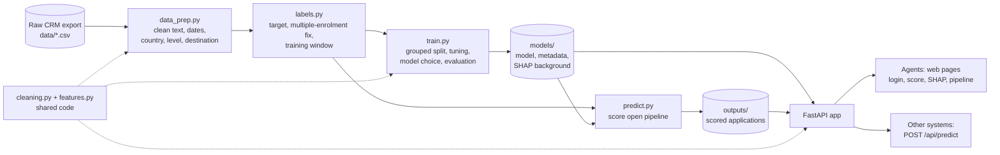

# Student Enrolment Predictor - Application Success Scoring for Higher Studies Inc. (A Study Abroad Agency)

**Background**
---
Over the past decade, the demand for higher education abroad has increased. Students are increasingly pursuing international qualifications for career advancement, access to high-quality academic resources and exposure to diverse cultural experiences. This trend has been supported by the expansion of transnational education partnerships and the widespread use of digital platforms to access program information.

As application volumes to universities and colleges continue to grow, both institutions and higher education agencies face more operational challenges. Managing large pipelines of applicants requires timely communication, efficient allocation of resources and effective tracking of each application's progress. While advancements in machine learning and data analytics present opportunities to improve decision-making, many organizations still rely on manual or intuition-based processes, which limits their ability to respond quickly to applicant behavior and market dynamics.

**The Problem**
---
Despite routinely collecting significant volumes of application and enrollment data, many agencies fail to fully leverage this information to guide strategic actions. This often results in inefficient resource allocation, such as repeated follow-ups with low-probability leads while high-potential candidates receive insufficient attention. In addition, students frequently disengage at various stages of the application process, yet the exact causes and critical drop-off points remain poorly understood.

These challenges highlight the need for a robust analytical framework capable of both predicting the likelihood of a student enrolling. Such a framework would enable the agencies to prioritize efforts on the most promising applicants, address bottlenecks in the recruitment pipeline and ultimately improve conversion rates in a competitive global education market.

**Goal** 
---
To build a model that gives each application a **probability of success (enrolment)** that agents can use to prioritise their pipeline of applications.

## Results (held-out test set, grouped by student)

| Metric | Value |
|---|---|
| ROC-AUC | 0.809 (cross-validation 0.817) |
| PR-AUC | 0.494 vs 0.166 base rate (cross-validation 0.494) |
| Brier score | 0.111 vs 0.138 for the base rate (19.5% skill) |
| Top 10% of scores | 51.4% enrolment, 3.1× the average |
| Top 30% of scores | 64% of all enrolments |
| Priority bands | High 37.0%, Medium 22.6%, Low 4.7% enrolment |
| Temporal check (train on older, test on newer) | ROC-AUC 0.771: performance drops over time, so the model needs regular retraining |

Full reasoning, EDA, hypothesis tests, leakage audit and technique justification are in `notebooks/student_enrollment_predictor.ipynb`.

## Architecture



The cleaning and feature code (`src/cleaning.py`, `src/features.py`) is shared by training and the API, so a new application is processed exactly like the training data.

## Project structure

```
.
├── AI_USE.md
├── Dockerfile
├── README.md
├── app
│   ├── __init__.py
│   ├── auth.py
│   ├── main.py
│   ├── model_service.py
│   ├── schemas.py
│   ├── static
│   │   ├── icon.png
│   │   ├── login-illustration.avif
│   │   ├── login-illustration_1.jpg
│   │   └── style.css
│   └── templates
│       ├── base.html
│       ├── login.html
│       ├── pipeline.html
│       ├── result.html
│       └── score.html
├── data
│   ├── Raw_Deals_Data.csv
│   ├── higher_studies_inc_pseudonymised_data.csv
│   ├── interim
│   │   ├── clean.pkl
│   │   └── data_info.json
│   └── processed
│       └── applications.pkl
├── docker-compose.yml
├── docs
│   ├── DSA 8401 Applied Machine Learning.docx
│   ├── DSA 8401 Applied Machine Learning.pdf
│   ├── Enrolment Outlook Predicting Application Success for a Study-Abroad Agency.docx
│   └── Enrolment Outlook Predicting Application Success.pptx
├── models
│   ├── README.md
│   ├── enrolment_model.joblib
│   ├── model_metadata.json
│   └── shap_background.pkl
├── notebooks
│   ├── artifacts
│   │   ├── models
│   │   │   ├── enrolment_model.joblib
│   │   │   └── model_metadata.json
│   │   └── outputs
│   │       ├── open_applications_scored.csv
│   │       └── train_test_split.csv
│   ├── data_pseudonimiser.ipynb
│   └── student_enrollment_predictor_v3.ipynb
├── outputs
│   ├── open_applications_scored.csv
│   └── train_test_split.csv
├── pytest.ini
├── reports
│   ├── lift_table.csv
│   └── metrics.json
├── requirements.txt
├── src
│   ├── __init__.py
│   ├── cleaning.py
│   ├── config.py
│   ├── data_prep.py
│   ├── evaluate.py
│   ├── explain.py
│   ├── features.py
│   ├── labels.py
│   ├── model.py
│   ├── pipeline.py
│   ├── predict.py
│   └── train.py
└── tests
    ├── __init__.py
    ├── test_api.py
    ├── test_cleaning.py
    └── test_features.py
```

## How to reproduce

Put the CRM data at ~data/higher_studies_inc_pseudonymised_data.csv` first.

### Option A: Docker (recommended)

```bash
cp .env.example .env # then change the password and secret
docker compose run --rm train # cleans data, trains, evaluates, scores the open pipeline
docker compose up api # http://localhost:8000
```

The same image is used for training and serving, so the model is always loaded with the library versions it was trained with. The image uses Python 3.14. If a library has no build for that version on your machine, build with `docker compose build --build-arg PYTHON_VERSION=3.13` and re-run the training step.

### Option B: local Python

```bash
python -m venv .venv && source .venv/bin/activate      
pip install -r requirements-dev.txt
python -m src.pipeline  # full pipeline (it would take about 1-2 minutes)
uvicorn app.main:app --reload  # http://localhost:8000
pytest                                                  
```

Every random step uses `RANDOM_STATE = 42`, so re-running gives the same model and metrics.

## Using the service

### Web app (agents)
Open http://localhost:8000 and sign in with the demo account set by `AGENT_EMAIL` and `AGENT_PASSWORD` (These values can also be set in the `env` file, but in a production setting an authentication service/manager will be better).

- **Score an application**: enter the details known when the application is created. The result page shows the probability, the priority band, and a SHAP breakdown of how each factor moved the score up or down from the average application.
- **Open pipeline**: open applications ranked by score, filterable by Opportunity ID (full or partial), deal owner and priority. Select an Opportunity ID to open that application's page with its score, current stage and SHAP breakdown; an exact ID in the search box goes straight there.
- The score form also takes an optional Opportunity ID, shown on the result page for reference only; the model never uses it.

The login is a demo placeholder, not production authentication.


## Key design decisions

- **Target:** enrolment (*Student Enrolled*, *Enrolled, but Dropped Out*, *Enrolled, but no Commission*) vs. closed/lost. Open applications are scored, not trained on. Early-stage applications open for more than 12 months count as lost.
- **No leakage:** only information known when an application is created is used. Milestone dates, payments, visa fields and profile fields filled in later are excluded (the notebook's leakage audit shows what they would do to the metrics).
- **Grouped by student:** a student's applications are never split between training and test.
- **Multiple enrolments:** if exactly one enrolled application has an `Enrolled Date` it is kept; otherwise the student is removed, because the real enrolment cannot be identified.
- **Training window:** only applications whose intake has passed are used for training, which avoids right-censoring.
- **Model:** histogram gradient boosting tuned with grouped cross-validation (one-standard-error rule), chosen over logistic regression on out-of-fold PR-AUC and Brier score. Class weighting was rejected because it distorted the probabilities.
- **Explanations:** SHAP permutation explainer on the original features, so each contribution maps to something an agent recognises.

## Limitations

- The data is a single CRM snapshot: fields hold their latest value, not their value when the application was created.
- Performance drops on newer applications (temporal ROC-AUC 0.745), so the model needs periodic retraining and drift monitoring.
- `Deal Owner` is the strongest feature. It reflects agent skill and lead allocation, and new agents fall into an "infrequent" group until their applications close.

